# 💫 About Me:
Software Engineer with hands-on experience in Python backend development, REST API design, data pipeline engineering and cloud deployment. Focused on Test-Driven Development, clean code and collaborative engineering practices, having built and deployed data solutions on AWS using Terraform. Skilled in agentic software development using GitHub Copilot, applying a review-and-verify workflow and Skills to accelerate development. Experienced in developing AI-powered applications, including RAG systems using pgvector and OpenAI APIs. Proactive and collaborative - enjoys taking ownership of features end-to-end and working closely with engineers and non-technical teams.  

## 🌐 Socials:
 

# 💻 Tech Stack:

# 📊 GitHub Stats:
 

<!-- Proudly created with GPRM ( https://gprm.itsvg.in ) -->
